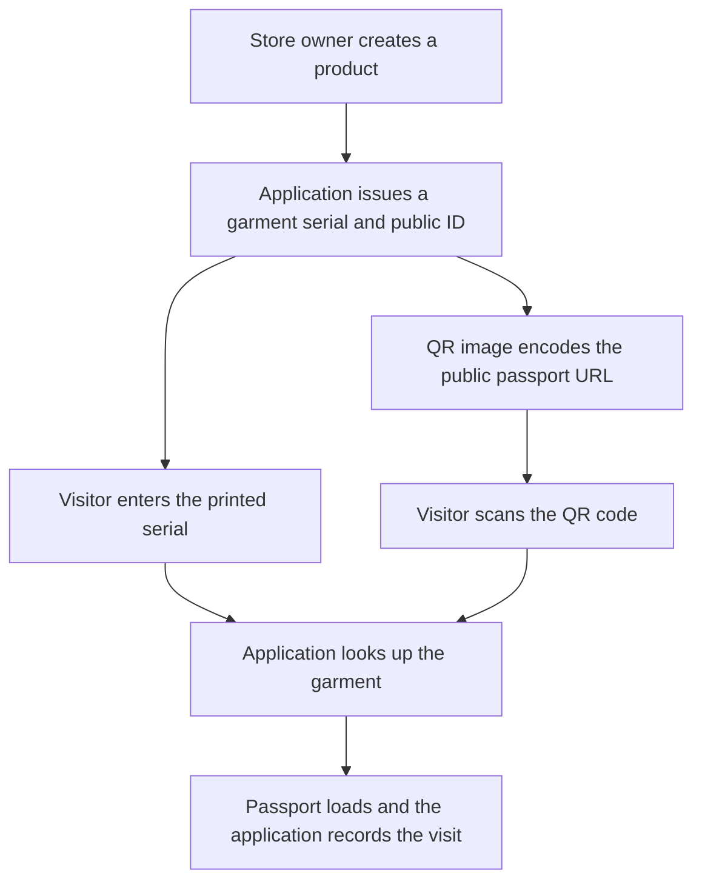

# Digital Product Passport

## Contents

- [Overview](#overview)
- [Run locally](#run-locally)
- [Issue a garment label](#issue-a-garment-label)
- [Find a garment passport](#find-a-garment-passport)
- [How it works](#how-it-works)
- [What the passport shows](#what-the-passport-shows)
- [Architecture and source layout](#architecture-and-source-layout)
- [Data model](#data-model)
- [Application routes](#application-routes)
- [Database migrations](#database-migrations)
- [Deploy the application](#deploy-the-application)
- [Run the NUnit tests](#run-the-nunit-tests)
- [Troubleshooting](#troubleshooting)

## Overview

Digital Product Passport lets textile brands issue a QR label and a unique serial number for each garment. Anyone can open a garment's passport to see its material composition, supply chain, environmental metrics, and care instructions. Store owners manage products and labels and review passport activity in a dashboard.

The catalog has two levels. A **product** such as an organic cotton T-shirt holds information shared across its garments. Each **garment** has its own serial number and public passport link, so two shirts of the same size and color can be identified individually.

| Audience | What they can do |
| --- | --- |
| Shoppers and garment owners | Scan a QR code, enter a serial number, read the public passport, and copy or share its link. |
| Store owner | Create brands and products, enter material and supply-chain information, issue labels, revoke garments, and view passport activity. |
| Developers and operators | Run the MVC app and SQL Server locally, apply schema migrations, and verify lookup behavior with NUnit. |

The interface supports English, Turkish, and German and has light and dark themes. The language menu sets a preference cookie. Without a saved preference, the app uses a supported language from the browser request and defaults to English.

## Run locally

### Prerequisites

- .NET 10 SDK.
- A SQL Server instance accessible from the application. The PowerShell example uses SQL Server LocalDB on Windows.
- A browser. Camera scanning also needs a camera, browser permission, and a secure context.

### Start the development app

From the repository root, open the directory that contains the solution, restore the dependencies, and trust the development HTTPS certificate.

```powershell
Set-Location .\DigitalProductPassportApp\DigitalProductPass
dotnet restore .\DigitalProductPass.slnx
dotnet dev-certs https --trust
```

Set the database connection and choose local store owner credentials. Use a SQL Server instance and database you have permission to create or update.

```powershell
$env:ConnectionStrings__DefaultConnection = 'Server=(localdb)\MSSQLLocalDB;Database=DigitalProductPassDev;Integrated Security=True;TrustServerCertificate=True'
$env:StoreOwner__Username = 'local-owner'
$env:StoreOwner__Password = 'replace-with-your-local-password'

dotnet run --project .\DigitalProductPass\DigitalProductPass.csproj --launch-profile https
```

Open **https://localhost:7028**. The HTTPS launch profile starts the app in Development, where startup applies the committed migrations and seeds demo data. On an empty database, the seed includes a demo brand, an organic cotton T-shirt product, and three labeled garments.

For a first check, sign in and open **Products**. Select **Organic Cotton T-Shirt** under **Demo Textile**, then choose **Open passport** on one of its garment rows. You can browse an existing passport immediately or use the next section to issue a new label.

### Configuration

Set these environment variables in the shell or deployment environment that starts the app. They override the corresponding values in `appsettings.json`.

| Environment variable | What it controls |
| --- | --- |
| `ConnectionStrings__DefaultConnection` | SQL Server connection string used by the application. |
| `StoreOwner__Username` and `StoreOwner__Password` | Credentials for the configured store owner account. Set both to deployment-specific values in production. |
| `PublicBaseUrl` | Optional externally reachable HTTPS base URL embedded in generated QR codes. If unset, the app uses the scheme and host of the request that generates the image. |

## Issue a garment label

1. Sign in at `/Account/Login` using the configured store owner credentials.
2. Open **Products** and select the demo product, or create a brand at `/Brands/Create` and a product at `/Products/Create`. Enter the product's SKU and a differentiation code of two to six letters or digits. Add a valid GTIN if the labels should use GS1 Digital Links.
3. Open the product details page. Add materials and supply-chain steps as needed, then issue items from the variants section. Each operation can issue 1 to 500 garments. The form accepts an optional color, size, and batch number. A batch number can contain up to 20 letters, digits, or hyphens.
4. Download the QR label as PNG or SVG and record the **Serial SKU** shown beside it. Each row represents a single garment and links to its public passport.

### Try it with the demo product

1. In **Variants & QR codes**, set the quantity to `1`, use the product's differentiation code `TSHORG`, and enter `White`, `M`, and `B2026-05` as the color, size, and batch.
2. Select **Issue variant SKUs**. Copy the generated **Serial SKU** from the new row. Its random suffix is generated when the garment is issued.
3. Open **Scan**, paste the serial into the manual form, and select **Show passport**. The passport should display the same serial, color, size, and batch as the row.
4. Use **Show QR code** on the passport to see the encoded link and its download options.

### Revocation and dashboard

Use **Revoke** in the garment row to record that an item has been withdrawn. The app keeps the garment and its public link so someone who scans an existing label can see the revocation warning.

The dashboard shows catalog totals, today's passport opens, opens over the last seven days, frequently opened products, and recent events with the garment serial. Each successful passport request counts as an event, including repeat visits and direct link visits. Day boundaries and displayed event times use UTC.

## Find a garment passport

| Method | Steps |
| --- | --- |
| Browser scanner | Open `/scan`, select **Start camera**, grant permission, and point the camera at the QR code. |
| Manual entry | Open `/scan`, enter the full serial number or paste a passport link, and select **Show passport**. |
| Phone camera | Scan the printed QR with the camera app and open the detected link. The phone must be able to reach the address in the QR. |
| Shared link | Open a passport URL copied from the product row or the passport's QR dialog. |

### Identifiers

| Identifier | Example | What it identifies |
| --- | --- | --- |
| Garment serial number | `TSHORG-WHI-M-7K3M9` or legacy `DPP-7K3M-9QXA` | One garment. Use the full serial printed on the label. Manual entry ignores surrounding whitespace and letter case and accepts common dash variants. |
| Product SKU | `TSH-ORG-001` | A product within a brand. Find it in the store owner catalog. |
| GTIN | `05901234123457` | A GS1 trade item. The QR lookup combines it with a garment serial and, when included, the batch number. |
| Differentiation code | `TSHORG` | The product or label prefix used as the first part of new garment serials. |
| Batch number | `B2026-05` | An optional production lot that can be shared by several garments. |
| Public ID | A GUID such as `072790c3-0962-4789-a681-7126d531f8b7` | One garment. It can be entered directly or used in a `/p/{publicId}` link. |

New serials use the format `CODE-COL-SIZE-RANDOM` and fit within 20 characters. The app shortens and normalizes the color and size for the serial while keeping the entered values on the garment record. It generates a five-character suffix that avoids visually ambiguous characters such as `O` and `0`. The database enforces unique garment serials and public IDs. Copy a real serial from your product details page to try the lookup.

### QR link formats

| Garment information | Encoded path |
| --- | --- |
| Product without a GTIN | `/p/{publicId}` |
| Product with a GTIN | `/01/{gtin14}/21/{serial}` |
| Product with a GTIN and a garment batch | `/01/{gtin14}/10/{batch}/21/{serial}` |

When a product is created with a GTIN, the application validates the check digit and stores the GTIN as 14 digits, padding valid GTIN-8, GTIN-12, and GTIN-13 codes with leading zeros. In the resulting GS1 Digital Link, `01` identifies the GTIN, `10` the batch or lot, and `21` the serial.

### Test a QR code on a phone

Set `PublicBaseUrl` to the deployed HTTPS address or an HTTPS development tunnel before generating labels for another device. Restart the app, download the QR image again, and verify the resulting URL from the phone. `localhost` on the phone refers to the phone itself. Previously downloaded labels keep the URL they were generated with, and the QR image endpoint allows browsers to cache images for an hour.

## How it works



1. **Save the product.** The owner selects a brand and enters the product SKU, differentiation code, and any shared information such as materials and weight. SQL Server stores the product and its related records.
2. **Issue garments.** The app generates serial candidates, checks them against stored serials, and saves a garment record with its own public GUID. The database's unique indexes also enforce uniqueness when items are saved.
3. **Generate the label.** When a browser requests a PNG or SVG, the QR controller loads the garment and its product. The link service chooses a public GUID or GS1 URL, and QRCoder renders that URL into an image.
4. **Resolve the input.** The browser scanner decodes the image and calls `GET /scan/resolve`. The manual form posts to `/scan`. Both use the same lookup rules. Plain serials are normalized before matching, public GUIDs are checked against stored garments, and GS1 links must match the GTIN, serial, and supplied batch on the same garment. A successful lookup redirects to `/p/{publicId}`.
5. **Render the passport.** A phone camera or shared link can also open a public passport route directly. The passport controller loads the garment, brand, materials, supply-chain steps, and certificates, records the visit, and renders the Razor view.

Blank or unrecognized inputs return to the scanner with a message. A recognized passport route that has no matching garment shows the not-found page with HTTP 404.

## What the passport shows

| Section | Information displayed |
| --- | --- |
| Garment identity | Product and brand names, serial, production date, and any recorded color, size, batch, image, or description. |
| Environmental impact | Carbon footprint in kg CO₂e, water use in liters, recycled material percentage, recyclability out of 100, and repairability out of 10. |
| Materials | Composition by percentage, origin, recycled status, carbon indices, and material certificate codes where available. |
| Supply chain | Ordered facility steps from raw materials through distribution, with country and date when supplied. |
| Care and end of life | Washing instructions and guidance for repair, reuse, or disposal entered for the product. |
| Certificates | Product certificate information, including issuer, expiration date, and document link when available. |
| Public link | A QR image, copyable URL, and PNG or SVG downloads. Withdrawn garments show a revocation warning. |

### How the material carbon footprint is calculated

The application multiplies each material's carbon index by its share of the garment. It adds the weighted values to get **kg CO₂e per kg of material**, then multiplies that index by the garment's weight in kilograms. The shares must total 100% within 0.01 percentage points, every material needs an index, and the garment needs a positive weight.

For the seeded T-shirt, 95% organic cotton at `3.8` kg CO₂e/kg and 5% elastane at `2.9` kg CO₂e/kg produce a weighted index of `3.755` kg CO₂e/kg. At `0.2` kg, the calculated material footprint rounds to `0.75` kg CO₂e.

When available, the calculated material footprint is the headline value and the declared whole-life footprint appears separately. If the inputs for the calculation are incomplete, the declared footprint is shown when supplied. [Carbon calculator](DigitalProductPass/Services/CarbonCalculator.cs)

## Architecture and source layout

The solution contains an ASP.NET Core MVC application and an NUnit test project. Razor views render the public and store owner pages. The controllers handle form submissions and route requests to EF Core, which reads and writes SQL Server. JavaScript handles browser camera scanning, theme selection, and copying passport links.

| Location relative to the solution | Responsibility |
| --- | --- |
| [`DigitalProductPass/Program.cs`](DigitalProductPass/Program.cs) | Application startup, service registration, SQL Server configuration, cookie authentication, routing, and Development initialization. |
| [`DigitalProductPass/Controllers/`](DigitalProductPass/Controllers) | Public scanner, passport and QR endpoints, plus store owner sign-in, catalog management and dashboard. |
| [`DigitalProductPass/Models/`](DigitalProductPass/Models) | Entities and form validation rules. |
| [`DigitalProductPass/Services/`](DigitalProductPass/Services) | Serial generation, GTIN checks, shared lookup rules, link and QR generation, carbon calculations, and UI translations. |
| [`DigitalProductPass/Views/`](DigitalProductPass/Views) and [`wwwroot/`](DigitalProductPass/wwwroot) | Razor templates, styles, scripts, and static assets. |
| [`DigitalProductPass/Data/`](DigitalProductPass/Data) and [`Migrations/`](DigitalProductPass/Migrations) | EF Core context, demo seed, and committed SQL Server schema changes. |
| [`DigitalProductPass.Tests/`](DigitalProductPass.Tests) | NUnit integration tests for label lookup and public passport routes. |

Store owner sign-in uses one configured account and an authentication cookie that carries the `StoreOwner` role. The role guards product and brand management and the dashboard. The scanner and public passport pages are accessible without sign-in. The manual lookup form and store owner write forms validate antiforgery tokens.

## Data model

Brands own products. Products own garment records and hold the material composition, supply-chain steps, and certificates shared by those garments. Passport visits are recorded against individual garments.

| Entity | What it stores |
| --- | --- |
| `Brand` | Name and optional country and website. A brand can have many products. |
| `Product` | Brand, product SKU, optional GTIN, label prefix, descriptive information, and shared environmental and care fields. |
| `ProductItem` | One issued garment with a product reference, unique serial, public GUID, variant details, production date, and revocation state. |
| `Material` | A component's share, origin, recycled flag, carbon index, and optional certificate code. |
| `SupplyChainStep` | An ordered stage with a facility, country, and optional date. |
| `ProductCertificate` | Certificate name and any supplied issuer, expiration date, and document URL. |
| `ScanEvent` | Garment reference, UTC timestamp, and the request's user agent truncated to 300 characters. |

The database enforces product SKU uniqueness within a brand and garment serial and public GUID uniqueness across the catalog. A timestamp index supports dashboard queries over recent passport visits. [Database context](DigitalProductPass/Data/ApplicationDbContext.cs)

## Application routes

| Route | Access | Purpose |
| --- | --- | --- |
| `GET /` | Public | Open the home page and navigate to the scanner. |
| `GET /scan` | Public | Show the camera and manual lookup form. |
| `POST /scan` | Public | Submit the `code` field with the form's antiforgery token. |
| `GET /scan/resolve?code=…` | Public | Resolve a decoded camera payload to the canonical passport. |
| `GET /p/{publicId}` | Public | Open the passport for a garment. |
| `GET /01/{gtin14}/21/{serial}` | Public | Open a passport by GS1 GTIN and serial. |
| `GET /01/{gtin14}/10/{batch}/21/{serial}` | Public | Open a passport by GS1 GTIN, batch, and serial. |
| `GET /qr/{publicId}.png` or `GET /qr/{publicId}.svg` | Public | Generate the garment's QR image. |
| `GET /lang/{culture}` | Public | Set the UI language to `en`, `tr`, or `de`. |
| `GET /Account/Login` and `POST /Account/Login` | Public | Display and submit the store owner sign-in form. |
| `/Products`, `/Products/Create`, `/Products/Details/{id}` | Store owner | Browse or create products and manage their materials, supply chain, and garments. |
| `/Brands/Create`, `/Dashboard` | Store owner | Create a brand or view passport activity. |

To inspect the lookup response from PowerShell, replace the example with a serial from your local catalog. A match returns a redirect whose `Location` contains `/p/{publicId}`. An unmatched input redirects to `/scan`.

```powershell
$garmentSerial = 'TSHORG-WHI-M-7K3M9'
curl.exe -sS -D - -o NUL --get --data-urlencode "code=$garmentSerial" https://localhost:7028/scan/resolve
```

## Database migrations

Development startup applies pending migrations and runs the demo seed. For a deployed database, apply the migrations as a separate step before starting the application. Configure `ConnectionStrings__DefaultConnection` for the target database and run the commands from the solution directory. Install the EF Core CLI if it is missing.

```powershell
dotnet tool install --global dotnet-ef --version 10.0.0
dotnet ef database update --project .\DigitalProductPass\DigitalProductPass.csproj
```

The initial schema and the `AddVariantSkusAndCarbonIndex` migration are already checked in. The second migration adds product sustainability and care fields, garment batch and revocation fields, and material carbon and certificate fields. The Development seed also backfills the older demo T-shirt when needed.

## Deploy the application

1. Provision the target SQL Server database and configure its connection string in the deployment environment.
2. Set deployment-specific `StoreOwner__Username` and `StoreOwner__Password` values. Store the connection string and credentials in the host's secret configuration.
3. Set the application environment to `Production` and set `PublicBaseUrl` to the HTTPS address that shoppers and phones can reach.
4. Apply the committed schema migrations to the target database.
5. Publish the project and start the published application with the deployment host. For a framework-dependent deployment, the host needs the ASP.NET Core 10 runtime.
6. Open the deployed scanner and sign in as the store owner. Issue one garment and verify that the same passport opens from both its printed serial and its QR code before distributing labels.

From the solution directory, publish the web application.

```powershell
dotnet publish .\DigitalProductPass\DigitalProductPass.csproj --configuration Release --output .\publish
```

The publish folder contains `DigitalProductPass.dll`. For a direct framework-dependent launch, run `dotnet DigitalProductPass.dll` with the publish folder as the working directory and the deployment configuration already set.

## Run the NUnit tests

From the solution directory, run the suite or filter to the garment lookup tests.

```powershell
dotnet test .\DigitalProductPass.slnx
dotnet test .\DigitalProductPass.slnx --filter 'FullyQualifiedName~PassportLookupTests'
```

The integration tests start the MVC app with a seeded in-memory SQLite database, so they can run without a SQL Server connection. They send HTTP requests to the application to verify behavior across routing, database queries, and view rendering. [NUnit test fixture](DigitalProductPass.Tests/PassportLookupTests.cs)

| Area | Coverage |
| --- | --- |
| Manual form | Render the scanner, submit its antiforgery token, and verify that current and legacy serials open the expected garment. |
| Camera endpoint | Resolve current serials, public GUIDs, resolver links, and GS1 links from a decoded payload. |
| QR generation | Check the PNG response and expected encoded URL for garments with a batch, without a batch, and without a GTIN. |
| Invalid input | Verify missing or partial codes and mismatched GTINs or batches. Unmatched direct GS1 requests return 404. |

### Manual verification

1. Open the deployed `/scan` page in a browser, grant camera permission, and scan a printed label or an image displayed on a second screen.
2. Compare the color, size, serial, and batch on the result with the garment row from the owner catalog.
3. Use the phone's native camera on the same label and confirm that its link opens the same passport.
4. Enter the printed serial manually, then add an extra character and confirm that the scanner displays a lookup error.

These device checks exercise camera permission, QR readability, and network reachability using the environment that will serve the labels.

## Troubleshooting

| Symptom | What to check |
| --- | --- |
| The browser camera does not start | Open the scanner over HTTPS, grant camera permission, and check that the page can load the scanner script from `cdn.jsdelivr.net`. The manual form can open a serial number or pasted passport link. |
| A QR works on the development computer but fails on a phone | Check the host in the QR link. Set `PublicBaseUrl` to a host the phone can reach and download a new image. |
| A serial search returns no match | Use the full **Serial SKU** from the garment row on the product page. An unknown code returns to `/scan` with a message. |
| A GS1 link returns 404 | Check the stored GTIN, serial, and batch against the link. Download a fresh label for the intended garment if the values differ. |
| The dashboard shows more visits than expected | Each successful passport request creates an event. Reloads, direct openings, and manual lookups all contribute to the count. |
| The owner login rejects the configured credentials | Check that both `StoreOwner__Username` and `StoreOwner__Password` are set in the process environment, then restart the app. |
| The passport shows the declared carbon footprint | Check the garment weight, the material percentages, and each material's carbon index. The calculated footprint appears when all required inputs are available. |
| Startup cannot connect to the database | Check the configured SQL Server instance, database name, and permissions. Development startup needs permission to apply migrations. |
| A migration says an object such as `Brands` already exists | Check whether the database was created before EF migration history was tracked. Use a fresh database name for disposable local testing. Back up any database whose data you need to retain before reconciling its schema and migration history. |
